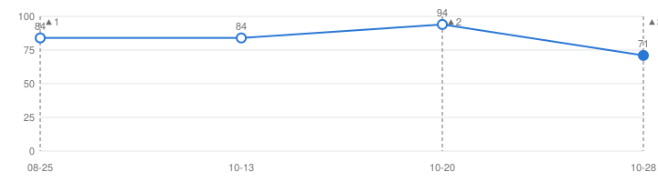
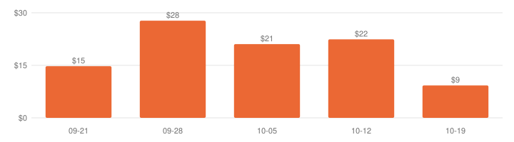
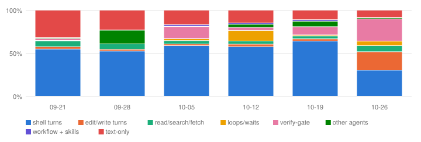

# Harness Receipts


**Michiel De Koninck** — I run this harness across my own projects. [GitHub profile](https://github.com/Michiel-DK) · built through it: [agent-sandbox](https://github.com/Michiel-DK/agent-sandbox), [warehouse-rl](https://github.com/Michiel-DK/warehouse-rl), [rlvr-codegen](https://github.com/Michiel-DK/rlvr-codegen) · in words: [one change traced end to end](TRACE.md), [three things that went wrong](FAILURES.md).

**In plain words.** A *harness* is the fixed set of steps an AI coding agent has to go through before its code is merged:
plan, build, get reviewed by other agents, get attacked by an agent whose only job is to find a reason not to ship, pass CI,
merge. This page is the weekly scorecard of one such harness, run by one developer across their own projects.
It shows what got shipped, what it cost, how often the gate caught something, and how healthy the setup itself is.
Every number is a count or a sum over rows the harness already writes. **No file paths, prompts, transcripts or
private repo names appear here, by construction**; the three public repos linked above are the one deliberate exception.
The score below is a health check of the setup, not a grade of the work.

Generated 2026-10-28 · 15 weeks since the harness went live (2026-07-20) · 887 merges · 3.14B tokens · $3,210 priced.
The interactive page (`index.html`) carries the same data with hover and table views. `node verify.js` re-derives every number below from `history.json`.

## What runs, and what each stage writes down

```
Loop 1 · one change
  stub + prediction ─► build ─► review ─► verify ─► CI ─► merge (session, operator token)
  (review-by date)    session   criterion  refuter    merge rows: merged / rejected,
                      rows      reviews    verdicts   CI colour, code vs docs
        ▲                                                   │
        └──── the prediction binds on what shipped; graded on its date ◄──┘

Loop 2 · the harness measuring itself (nightly + Monday)
  transcripts + GitHub ─► 4 miners ─► run ledger ─► scorecard ─► digest line + this page
  declared, not measured: MCP surface · not tracked yet: post-merge reverts / fix-forwards
```

## Outcomes — last 4 complete weeks vs the 4 before

| | last 4 weeks | prior 4 | all weeks since live |
|---|---:|---:|---:|
| credited merges (code-class + green CI at merge time) | **186** of 197 merged | 76 of 96 | 491 of 887 |
| CI green at merge | 97% | 100% | 94% |
| merged on red CI | 6 | 0 | 50 |
| rejected / superseded | 2 / 0 | 1 / 1 | 15 / 15 |
| sessions abandoned (edits, no PR) | 47% of 240 | 13% of 30 | 36% of 402 |
| refuter kill rate (verify gate) | 25% of 419 verdicts | 53% of 90 | 41% of 1206 |
| reverted after merge (of which credited) | 0 (0) | 0 (0) | 0 (0) |
| fix-forward candidates (weak link) | 2 | 9 | 21 |

The two windows are not the same population: the session roster grew on 2026-10-28 (two busy repos added), which is most of the jump in sessions and in the abandoned share. The all-weeks column is there so a bad early week cannot hide behind a good recent one.

**Predictions on the harness itself.** Every behavioural change ships with a pre-registered prediction and a review date. **51 grades so far over 40 stubs: 17 pass · 14 partial · 6 fail · 14 ungradeable.** 8 stubs are open with a date and 15 wait on an event, out of 70 stubs in all; the groups overlap, because a graded stub can be re-armed with a new date, and closed or parked stubs are in none.

## Harness score over time



A weighted roll-up over four structural checks (skills validate, routing fires, consumers sit at the pin, self-tests pass).
Hollow points were reconstructed by re-running the scorecard at past commits; filled points are live runs (Mondays from now on).
Dashed marks are changes to the instrument — a drop at a mark is a correction, not decay:

- ▲1 2026-08-25 — scorecard first wired (4 of 5 dimensions; drift scored on zero consumers)
- ▲2 2026-10-20 — skill validator fixed (#82) — skillsValid 66 → 91
- ▲3 2026-10-28 — drift measured over real consumers (S-166, #85) — 100-on-nothing becomes 0-of-7

Latest 2026-10-28: **71/100 B** — skillsValid 91 (w25) · triggersRouting 98 (w25) · reposInSync 0 (w20) · selfTested 88 (w15) · mcpSurface not measured (w15). Inactive dimensions are renormalised out and shown as "not measured", never scored full.

## Cost per credited merge



| week of | cost | credited | $ / credited | sessions priced | tokens | cache read |
|---|---:|---:|---:|---:|---:|---:|
| 2026-09-21 | $266 | 18 | $15 | 4 / 4 | 307.5M | 96% |
| 2026-09-28 | $361 | 13 | $28 | 7 / 7 | 326.1M | 95% |
| 2026-10-05 | $484 | 23 | $21 | 28 / 28 | 358.5M | 96% |
| 2026-10-12 | $1,076 | 48 | $22 | 75 / 75 | 973.7M | 97% |
| 2026-10-19 | $946 | 102 | $9 | 311 / 311 | 1.05B | 96% |

5 complete weeks with token rows: $3,133 over 204 credited merges, **$15 each**. The priced total in the header ($3,210) also includes the current, incomplete week. Dollars come from the CLI's own cost line; sessions without one are counted but not priced.

## Tokens per harness part



A turn is charged to its first tool call, and most tokens are cache reads, so this is the cost of *carrying context*
through a stage, not of generating output there. Classes are fixed: shell turns, edit/write turns, read/search/fetch,
scheduled loops and waits, the verify-gate agent, other agents (reviewers, explorers), workflow scripts + skills, text-only turns.

## Definitions

- **merge** — a pull request merged on GitHub in one of the repos the harness is mounted in. The build lane opens it and stops; after CI the main loop or the developer merges it, always under the developer's own account, so the page cannot tell the two apart. Most are opened by the lane, which is why a week can hold a hundred.
- **credited merge** — a merge that is code-class (by its changed paths, branch prefix as fallback) and whose CI was green at merge time. Merges older than the path data carry no class and count as neither code nor docs: 189 of 887 in this file.
- **merged on red CI** — merged while CI was failing. Whoever merged it, the gate was not green.
- **gate coverage** — review and refuter rows exist only for changes built through the lane workflow. A merge from a plain session has none, so a week can show credited merges with zero verdicts; "credited" does not require a verdict. That is a gap in the definition, kept visible rather than papered over.
- **session** — one interactive or lane session in a roster of repos, mined from the CLI's own transcripts; **token session** — any session with token usage, mined from every project directory including workflow worktrees. The second set is larger; the two are not the same population.
- **abandoned** — a session that edited files and opened no PR. This includes sessions that committed directly without a PR (documentation goes direct in some repos), so it over-counts true abandonment.
- **refuter verdict** — one lens of the verify gate on one change; *refuted* means it found a reason the change should not ship.
- **reverted after merge** — a later merged PR carries GitHub's own revert stamp (`Reverts owner/repo#N`) or is titled `Revert "<title>"`; counted in the week of the revert. **Fix-forward candidate** — a later PR on a fix/ or hotfix/ branch, merged within 14 days, touching a code file the credited merge touched; a weak link, shown separately and never added to reverted. The detector first ran on 2026-10-28 over the previous 90 days of merges, so candidates appear from 2026-07-30 on; weeks before that show 0 because nothing looked, not because nothing happened.
- **reconstructed score point** — the scorecard re-run at a past commit in today's environment, plotted as the instrument scored it then, vacuous drift included; the note on each point gives the three-dimension number.
- weeks with no rows at all are absent from the series rather than drawn as zero.

## Limits, stated

- One developer, one harness, a few months of rows. No control arm: nothing here says what the numbers would be without the harness.
- The three linked repos are public snapshots of work built through the harness; most merges counted here happened in repos that stay private.
- Before the harness went live, the same repos had 1609 merges over 25 weeks (2026-01-19 to 2026-07-13): 93% green at merge, 110 merged on red. No agents, no gate, partly different repos — not a control arm, shown so the cut at 2026-07-20 is visible rather than hidden.
- The badge and the latest score point are the last published run. The number can move between runs (it did on 2026-10-28, see TRACE.md); the next Monday run publishes the new one.
- The score measures structure, not outcomes. The outcome numbers stop at merge time.
- Token history begins when transcript mining started; earlier sessions are gone.

## Files

| file | what |
|---|---|
| `history.json` | every number here — counts and sums per ISO week, score points per run, dated instrument changes, the prediction tally |
| `index.html` | the interactive page (hover, table views, dark mode) |
| `badge.json` | shields.io endpoint with the latest grade |
| `score.svg`, `cost.svg`, `parts.svg` | the charts above, rendered by the writer — no JS |
| `verify.js` | re-derives every number on this page from `history.json`; run `node verify.js` |
| `TRACE.md` | one harness change followed from observation to grade |
| `FAILURES.md` | a refuter kill, a prediction that failed and fired its own kill clause, the nine-week vacuous score |

Generated after the Monday digest by a writer that lives in the private harness repo, so its redaction tests cannot be checked from here.
What can be checked: every number on this page re-derives from `history.json`. No field in that file carries a path, a repo name, a prompt or a transcript; the only prose is the note on each score point and the label on each instrument change.
